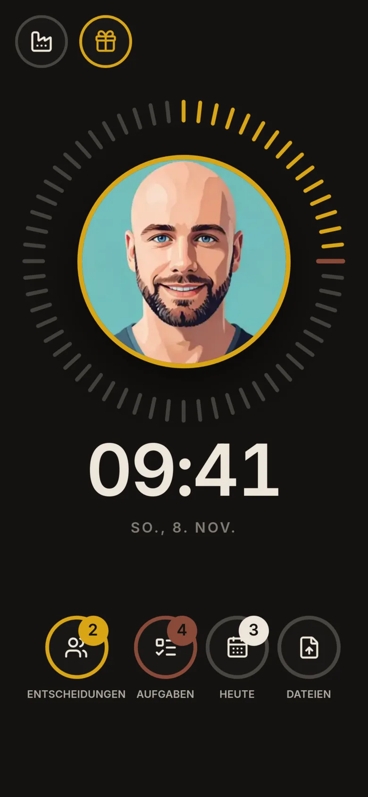
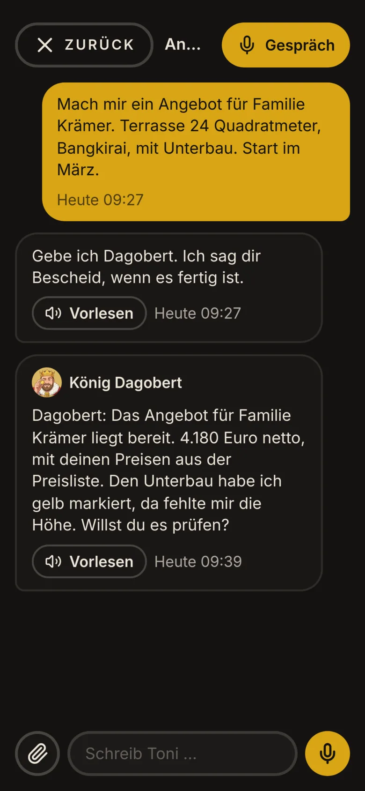
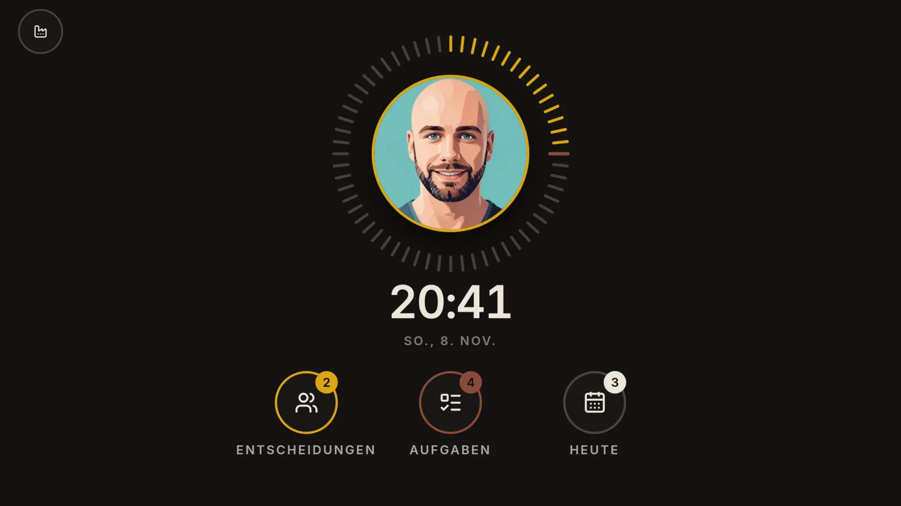
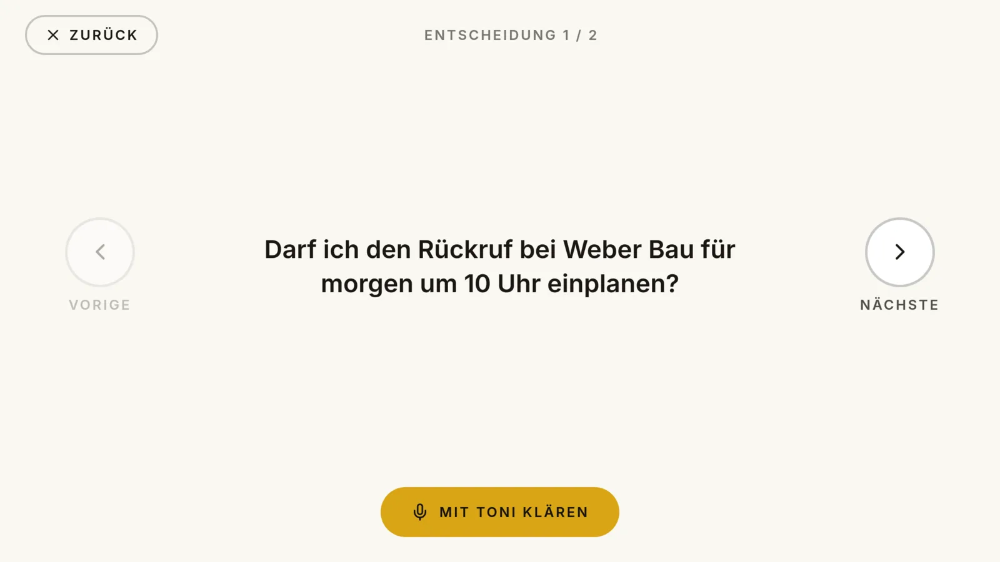
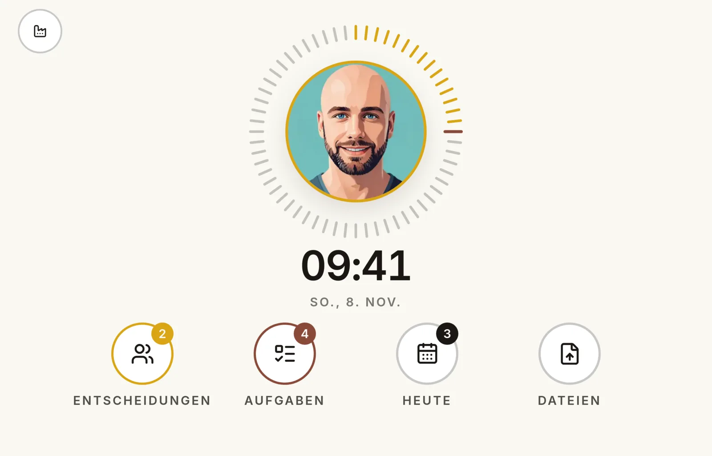
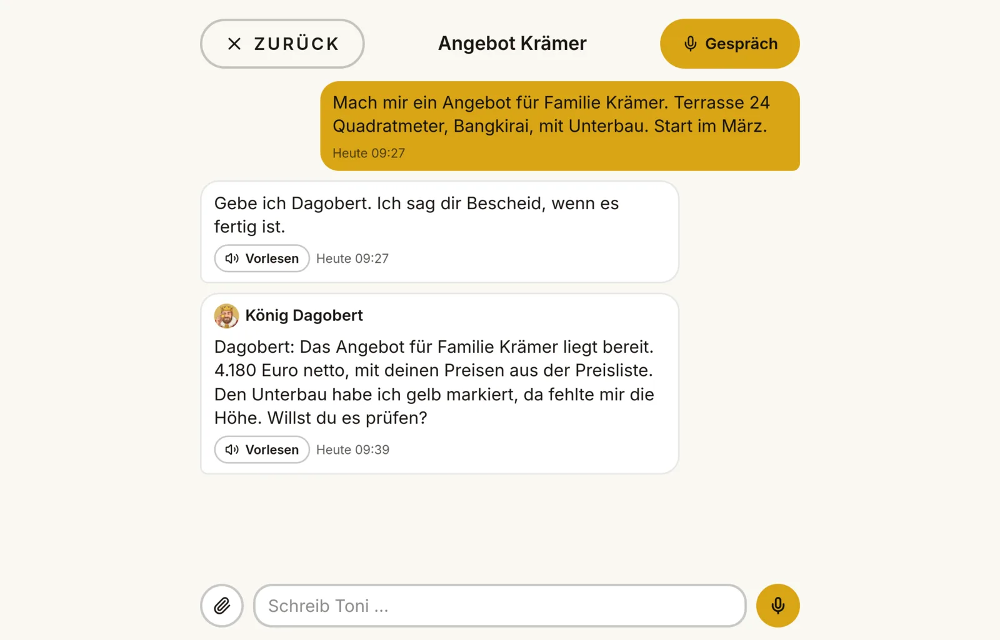

# Toni SDK für Python

[](https://pypi.org/project/toni-sdk/) [](https://www.python.org) [](LICENSE) [](https://ki-markt.com/api-referenz)

**Der KI-Agent für Selbständige und Unternehmer.** Toni weiß schon, wie ein kleines Unternehmen arbeitet: Kunden und Anfragen, Angebote, Rechnungen, Inhalte, Wissen und KI-Mitarbeiter, die wiederkehrende Aufgaben übernehmen. Über 260 Funktionen sind fertig eingebaut. Du betreibst keinen Server und verwaltest keine Modell-Schlüssel. Dieses SDK bringt die Agenten-Schleife, jede Funktion als dokumentierte Methode, ein OpenAI-kompatibles Gateway und Toni fürs Terminal. Es braucht keine weiteren Pakete.

Nutze Toni für sich, als gehostete Alternative zu [Hermes Agent](https://github.com/NousResearch/hermes-agent) und [OpenClaw](https://github.com/openclaw/openclaw). Oder behalte dein OpenClaw oder Hermes und [binde Toni dort ein](#toni-in-openclaw-oder-hermes-agent-nutzen), als den Teil, der dein Unternehmen kennt.

[English](README.md) · [Node.js](https://github.com/stefanhaab/toni-sdk-nodejs) · [PHP](https://github.com/stefanhaab/toni-sdk-php) · [API-Referenz](https://ki-markt.com/api-referenz) · [ki-markt.com](https://ki-markt.com)

```bash
pip install toni-sdk
```

```python
from toni_sdk import Toni

toni = Toni()  # liest TONI_API_KEY

ergebnis = toni.agent(areas=["crm"]).run("Wer hat sich diese Woche gemeldet, und wer wartet noch auf Antwort?")
print(ergebnis.text)
```

Einen Schlüssel (`km_live_…`) erzeugst du im Konto unter „API“ auf [ki-markt.com](https://ki-markt.com). Neue Konten starten mit Testguthaben.

## Was Toni kann

Toni ist der digitale Assistent eines Unternehmens. Du sprichst mit ihm wie mit einem Stabschef: per Sprache, im Chat, am Telefon, im Auto, am Handgelenk. Er spricht dich mit Du und Vornamen an, arbeitet im Namen deines Unternehmens und fragt, bevor er etwas tut, das sich nicht zurücknehmen lässt.

### Er kennt das Unternehmen

Die meisten Assistenten fangen in jedem Gespräch bei null an. Toni fängt beim Kontext an, den die Plattform einmal aufbaut und aktuell hält:

- **Interviews**: Du erzählst ihm in einem Gespräch, was dein Unternehmen tut, für wen, und welche Probleme es löst. Alles andere greift darauf zurück.
- **Wissensgraph**: Leads, Termine, Angebote, Bücher, Kurse und Interviews hängen zusammen. So hat „Wer war noch mal der Kunde mit der Terrasse?“ eine Antwort.
- **Sprachprofil**: wie du sprichst und schreibst, damit Texte nach dir klingen und nicht nach Vorlage.
- **Geschäftsmodell**: womit du Geld verdienst und wie Angebote gerechnet werden.
- **Zielgruppe**: die emotionalen Antriebe deiner Kunden (Limbic-Typen), Suchbegriffe mit ihrer Absicht und der Storyfilter, der festlegt, wie deine Geschichte erzählt wird.
- **Handbuch, Glossar, Expertise, Kundenstimmen**: die Arbeitsanweisungen und Belege des Unternehmens.

### Er erledigt die Arbeit

- **Kunden und Vertrieb**: Leads mit ihrer Herkunft, Kontakte, Termine und Aufgaben; Angebote aus dem Geschäftsmodell; Rechnungsentwürfe; ein Blick auf offene und überfällige Rechnungen.
- **Kundensupport**: Nachrichten aus E-Mail, Shop-Plattformen, Kommentaren und Messengern an einem Ort, mit vorbereiteten Antworten.
- **Aufgaben, Erinnerungen und Notizen**: Sag „Erinner mich am Freitag an den Rückruf bei Weber“ oder „Ist erledigt“, und es steht auf der Liste oder ist abgehakt.
- **Inhalte**: Landingpages, Portale, digitale Visitenkarten, QR-Codes mit Auswertung, Kampagnen. Bücher, Hörbücher, Podcasts und Kurse entstehen aus derselben Quelle wie alles andere: deinen Interviews, deiner Sprache, deinem Angebot.
- **Redaktion**: erkennt, wonach gesucht wird, schlägt Themen vor und lässt deine Seiten wachsen, sobald du freigibst.
- **Gespräche mit deinen Kunden**: Chat-Agenten, die auf deiner Webseite antworten, im Sprach-Chat sprechen und ans Telefon gehen.
- **Ziele**: Du setzt das Ziel, Toni führt Istwert, Prognose und Umsetzung.

### KI-Mitarbeiter

Du beschreibst eine Aufgabe einmal, und ein KI-Mitarbeiter erledigt sie von da an: nach Zeitplan oder wenn etwas passiert, etwa ein neuer Lead, eine eingehende Mail oder eine bezahlte Rechnung. Jeder hat Schritte, Leitplanken und ein Protokoll jedes Laufs. Lesen darf er von selbst. Alles, was schreibt, versendet oder veröffentlicht, wartet auf dein Ja, außer du hast es ausdrücklich erlaubt. Jede Änderung kannst du erst als Probe laufen lassen, bei der nichts geschrieben wird.

### Wo du ihn erreichst

| | |
|---|---|
| **Toni App** — auf dem Handy. Ein Tipp zum Sprechen, für eine Sprachnachricht oder den Chat. Entscheidungen, Aufgaben, die Termine von heute und Dateien sind je ein Knopf. Lade eine Datei hoch und sag Toni, was er damit tun soll. |   |
| **Toni Watch** — ein rundes Gerät am Band oder an der Wand. Sprich eine Idee hinein, sobald du sie hast; der Ring zeigt, ob Toni zuhört, nachdenkt oder dich braucht. |   |
| **Toni Car** — auf dem Bildschirm im Auto. Große Knöpfe, große Schrift, gemacht für einen Blick: Toni stellt eine Frage, du antwortest per Stimme oder mit einem Tipp. | <br> |
| **Toni Desktop** — auf dem Rechner. Derselbe Toni mit Platz für längere Chats; zieh Dateien hinein, und er liest sie. | <br> |

Die Bildschirme zeigen die echten Oberflächen mit erfundenen Beispieldaten. Toni gibt es außerdem im Web-Chat, am Telefon und als Büro-Dashboard für die Wand.

### Was es sicher macht

- **Ein Unternehmen je Schlüssel**: Unternehmen und Person kommen immer aus dem Schlüssel, nie aus der Anfrage.
- **Vier Rechte je Schlüssel**: lesen, schreiben, veröffentlichen, löschen. Ein Schlüssel hat keins, bis du es vergibst.
- **Ein Mensch bestätigt** Löschen und Veröffentlichen. Weder die API noch der Agent in diesem SDK lassen zu, dass ein Modell sich selbst bestätigt.
- **Datenschleuse**: für jeden Schlüssel von Haus aus an. Personenbezogene Daten in einem Text werden ersetzt, bevor ein Modell sie sieht, und in der Antwort wieder eingesetzt.
- **Abrechnung nach Nutzung**: Guthaben im Voraus, drei Modellgrößen, auf Wunsch ein Monatslimit je Schlüssel.

Mit diesem SDK nutzt du all das aus deinem eigenen Code.

## Toni, Hermes Agent, OpenClaw

Hermes Agent und OpenClaw sind quelloffene Agenten, die du selbst betreibst. Toni ist eine gehostete Plattform, die du aufrufst.

| | Toni | Hermes Agent | OpenClaw |
|---|---|---|---|
| Läuft | Gehostet, du rufst eine API auf | Auf deinem Rechner oder Server | Auf deinem Rechner oder Server |
| Einrichtung | `pip install`, ein Schlüssel | Installieren, einrichten, am Laufen halten | Installieren, einrichten, Dienst am Laufen halten |
| Modelle | Drei Größen inklusive, Abrechnung nach Nutzung | Eigene Modell-Schlüssel | Eigene Modell-Schlüssel oder lokale Modelle |
| Werkzeuge | Über 260 Funktionen, je Unternehmen getrennt | Fähigkeiten, die der Agent selbst schreibt, und aus der Community | Fähigkeiten aus der Community |
| Unternehmensdaten | CRM, Angebote, Rechnungen, Inhalte, Wissensgraph sind dabei | Bindest du selbst an | Bindest du selbst an |
| Unumkehrbares | Gesperrt, bis ein Mensch bestätigt | Je nach Einrichtung | Je nach Einrichtung |
| Personenbezogene Daten | Die Datenschleuse ersetzt sie, bevor ein Modell sie sieht | Je nach Einrichtung | Je nach Einrichtung |
| Wo du mit ihm sprichst | Toni App, Watch, Car, Desktop, Telefon, Web-Chat | Telegram, Discord, Slack, WhatsApp, Terminal | WhatsApp, Telegram, Slack und über 20 weitere, eigene Apps |
| Quelltext | SDK unter MIT, Plattform gehostet | MIT, ganz offen | MIT, ganz offen |

Nimm Hermes Agent oder OpenClaw, wenn alles auf deiner eigenen Hardware laufen soll und du einen persönlichen Assistenten in deinen Chat-Apps willst. Nimm Toni, wenn du selbständig bist oder ein Unternehmen führst und einen Agenten willst, der schon mit deinen Kunden, Angeboten und Rechnungen arbeitet, ohne dass du ihn betreibst. Du musst dich nicht entscheiden: der nächste Abschnitt zeigt, wie beides zusammen geht.

## Toni in OpenClaw oder Hermes Agent nutzen

Toni hat einen gehosteten MCP-Zugang. Dein OpenClaw- oder Hermes-Agent behält seine Chats, sein Gedächtnis und seine Skills und bekommt Toni als den Kollegen dazu, der das Unternehmen kennt. Zu installieren gibt es nichts.

- **Adresse:** `https://app.landingpage.tools/mcp`
- **Schlüssel:** einen Verbindungs-Schlüssel (`lpt_…`) erzeugst du im Download-Bereich deines Kontos unter „KI-Assistent verbinden“. Das ist ein anderer Schlüssel als der API-Schlüssel dieses SDK.
- **Werkzeuge:** `toni` übergibt eine Aufgabe an Toni, der mit dem Kontext des Unternehmens arbeitet und sich das Gespräch merkt. `suchen` durchsucht das Wissen des Unternehmens. `katalog` und `ausfuehren` erreichen die Funktionen der Plattform direkt. Die Rechte und die Bestätigung für Löschen und Veröffentlichen gelten auch hier.

Hermes Agent, in `~/.hermes/config.yaml`:

```yaml
mcp_servers:
  toni:
    url: "https://app.landingpage.tools/mcp"
    headers:
      Authorization: "Bearer lpt_…"
```

OpenClaw, im Block `mcp.servers` deiner Konfiguration (prüfen mit `openclaw mcp probe`):

```json
{
  "mcp": {
    "servers": {
      "toni": {
        "url": "https://app.landingpage.tools/mcp",
        "transport": "streamable-http",
        "headers": { "Authorization": "Bearer lpt_…" }
      }
    }
  }
}
```

Derselbe Zugang funktioniert in Claude, ChatGPT und jedem anderen MCP-Host. Einen fertigen Skill, der deinem Agenten sagt, wann er eine Aufgabe an Toni gibt, findest du in [`skills/toni`](https://github.com/stefanhaab/toni-sdk-nodejs/tree/main/skills/toni): den Ordner in das Skills-Verzeichnis von OpenClaw oder Hermes kopieren.

## Umstieg von OpenClaw oder Hermes Agent

| Was du kennst | Bei Toni |
|---|---|
| Skills | Über 260 fertige Funktionen; eigene ergänzt du mit `tools` |
| Gedächtnis, `SOUL.md`, `USER.md` | Interviews, Sprachprofil, Wissensgraph und Notizen, auf der Plattform gehalten |
| Cron und geplante Abläufe | KI-Mitarbeiter, die nach Zeitplan laufen oder wenn etwas passiert |
| Subagenten | KI-Mitarbeiter unter Toni, jeder mit Schritten, Leitplanken und Protokoll |
| Freigabe von Befehlen | Vier Rechte je Schlüssel, und ein Mensch bestätigt Löschen und Veröffentlichen |
| Modell-Anbieter und Schlüssel | Drei Größen inklusive, Guthaben, Abrechnung nach Nutzung |
| Gateway und Chat-Kanäle | Toni App, Watch, Car, Desktop, Telefon und Web-Chat |
| Ein Dienst auf deinem Rechner | Nichts zu betreiben |

## Der Agent

```python
agent = toni.agent(
    areas=["crm", "offers"],          # Funktionen dieser Bereiche werden Werkzeuge
    allow=["lesen", "schreiben"],     # Standard ist ["lesen"]: nur lesen
    instructions="Du arbeitest für einen Maschinenbauer.",
    on_step=lambda s: print("→", s.tool, s.args),
)

erst = agent.run("Leg einen Lead für Mira Beispiel an, mira@example.com.")
dann = agent.run("Und entwirf ein Angebot für sie.", messages=erst.messages)
```

- **Ohne `areas`** sucht der Agent selbst im ganzen Katalog (zwei Werkzeuge: suchen, aufrufen). Gut für offene Fragen.
- **Rechte** folgen vier Stufen: `lesen`, `schreiben`, `veroeffentlichen`, `loeschen`. Der Agent sieht nur Funktionen der Stufen, die du erlaubst, und der Schlüssel braucht dasselbe Recht in deinem Konto.
- **Löschen und Veröffentlichen** brauchen zusätzlich `on_confirm`. Das Modell kann nicht selbst bestätigen:

```python
toni.agent(
    areas=["books"],
    allow=["lesen", "loeschen"],
    on_confirm=lambda call: input(f"{call.title}: {call.args}? [j/N] ").lower().startswith("j"),
)
```

- **Eigene Werkzeuge** stehen neben den Funktionen der Plattform:

```python
from toni_sdk import Tool

toni.agent(tools=[Tool(
    name="bestand",
    description="Lagerbestand eines Artikels",
    parameters={"type": "object", "properties": {"sku": {"type": "string"}}, "required": ["sku"]},
    execute=lambda args: lager.bestand(args["sku"]),
)])
```

`run()` liefert `text`, `steps` (jeder Werkzeugaufruf mit Parametern, Ergebnis und Dauer), `messages`, `usage` und `finish`.

## KI-Mitarbeiter, die von selbst laufen

KI-Mitarbeiter, die du auf der Plattform anlegst, laufen ohne deinen Prozess weiter: nach Zeitplan oder bei Ereignissen wie einem neuen Lead oder einer eingehenden Mail.

```python
entwurf = toni.baukasten.agent_entwurf(name="Neue Leads prüfen", anweisungen="Bewerte jeden neuen Lead und notiere, warum.")
lauf = toni.baukasten.agent_starten(agent_id=entwurf["agent_id"], simulation=True)   # Probelauf: nichts wird geschrieben
status = toni.baukasten.agent_lauf_status(lauf_id=lauf["lauf_id"])
```

## Jede Funktion als Methode

```python
leads = toni.crm.get_leads(status="new", limit=10)
buch = toni.books.create_book(title="Weniger Büro")
toni.books.delete_book(book_id=12, confirmed=True)

toni.platform.call("crm", "get_leads", {"limit": 10})   # allgemeine Form
```

30 Bereiche, erzeugt aus dem OpenAPI-Dokument, mit den Parametern in jedem Docstring. Parameter gibst du als Schlüsselwörter oder als Dict an. Eine Funktion liefert `{"success": …, "data": …}`; ein fachlicher Fehler wie eine unbekannte ID kommt als `{"success": False, "error": …}` zurück und wirft nicht.

## KI-Gateway (OpenAI-kompatibel)

```python
text = toni.ask("Fass in zwei Sätzen zusammen, was ein Voicebot ist.")

for stueck in toni.stream("Erzähl mir etwas über Voicebots."):
    print(stueck, end="", flush=True)

strom = toni.chat.completions.create(
    model="toni-mittel",                       # toni-leicht · toni-mittel · toni-schwer
    messages=[{"role": "user", "content": "Hallo"}],
    stream=True,
)

toni.embeddings.create(input=["eins", "zwei"])
toni.audio.transcriptions.create(file="anruf.mp3", language="de")
toni.images.generate(prompt="Eine Werkstatt bei Sonnenaufgang")

video = toni.videos.create(prompt="Eine Drohne über einem Fabrikdach", seconds=5)
toni.videos.wait(video["id"])
mp4 = toni.videos.content(video["id"])

toni.prices()   # Größen und Preise, ohne Schlüssel
```

Du nutzt schon die OpenAI-Bibliothek? Richte sie auf `https://api.ki-markt.com/v1` und nimm deinen Toni-Schlüssel.

## Terminal

```bash
toni login                           # Schlüssel einmal speichern (oder TONI_API_KEY setzen)
toni "Welche Rechnungen sind überfällig?"
toni --bereiche crm --schreiben      # Gespräch, darf anlegen und ändern
toni funktionen lead                 # im Katalog blättern
toni verbinden hermes               # Konfiguration, um Toni in Hermes Agent oder OpenClaw einzubinden
```

`toni login` legt den Schlüssel in `~/.config/toni/config.json` ab, lesbar nur für dich. `toni logout` löscht ihn.

## Fehler

```python
from toni_sdk import ToniApiError, PermissionError

try:
    toni.crm.create_lead(data={"email": "mira@example.com"})
except PermissionError as e:
    print(e.code)                    # recht_fehlt
except ToniApiError as e:
    print(e.status, e.code, e)
```

`AuthenticationError` (401), `InsufficientCreditError` (402), `PermissionError` (403), `ConfirmationRequiredError` (409), `RateLimitError` (429), `ToniConnectionError` (keine Antwort). Lesende Anfragen werden bei 429 und 5xx wiederholt; schreibende Plattform-Aufrufe nie von selbst.

## Optionen

```python
Toni(api_key=None, base_url=None, timeout=120.0, max_retries=2, headers=None)
```

Umgebung: `TONI_API_KEY` (oder `KM_KEY`), `TONI_BASE_URL`. Python 3.9 oder neuer, keine weiteren Pakete.

## Noch nicht im SDK

Echtzeit-Sprache über WebSocket und ein asynchroner Client. Echtzeit-Sprache gibt es im [Node.js-SDK](https://github.com/stefanhaab/toni-sdk-nodejs).

## Entwicklung

```bash
python3 scripts/generate.py                  # src/toni_sdk/_generated aus dem aktuellen OpenAPI-Dokument neu erzeugen
python3 -m unittest discover -s tests -v
```

[Änderungen](CHANGELOG.md) · [Mitmachen](CONTRIBUTING.md) · [Sicherheit](SECURITY.md) · MIT
